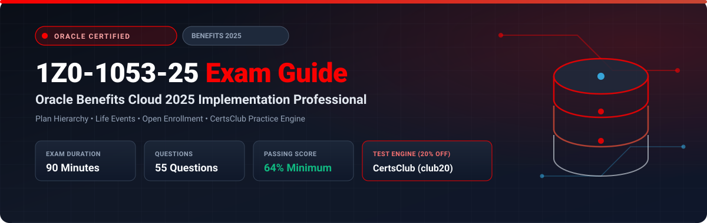

  

# Oracle Benefits Cloud 2025 Implementation Professional (1Z0-1053-25) Exam Study Guide & Practice Test Resource Portal

[-f80000?style=for-the-badge&logo=oracle&logoColor=white)](https://education.oracle.com/)
[-f80000?style=for-the-badge&logo=oracle)](https://education.oracle.com/)

[-28a745?style=for-the-badge&logo=shield)](https://www.certsclub.com/oracle/)

---

## 1. Exam Overview & Candidate Profile

The **Oracle Benefits Cloud 2025 Implementation Professional (1Z0-1053-25)** exam certifies that a candidate has the technical knowledge to configure and implement Oracle Fusion Cloud Benefits. Core domains tested include Benefits plan hierarchies (Programs, Plan Types, Plans, Options), Eligibility Profiles, Life Events (Open Enrollment, Unrestricted, and Work/Family life events), Standard/Variable rates, Flex Credits, and enrollment maintenance batch processes.

Passing 1Z0-1053-25 earns the **Oracle Benefits Cloud 2025 Certified Implementation Professional** credential.

### Target Candidate Profile & Career Roles
* **Oracle Benefits Functional Consultants & Implementation Specialists**
* **Total Rewards & Benefits Administration Leads**
* **HCM Cloud Systems Engineers**

---

## 2. Key Exam Specifications

| Parameter | Official Specification |
| :--- | :--- |
| **Exam Code** | 1Z0-1053-25 |
| **Exam Title** | Oracle Benefits Cloud 2025 Implementation Professional |
| **Associated Credential** | Oracle Benefits Cloud 2025 Certified Implementation Professional |
| **Duration** | 90 Minutes |
| **Number of Questions** | 55 Questions |
| **Passing Score** | 64% |
| **Question Format** | Multiple Choice (Single and Multiple Select) |
| **Delivery Vendor** | Pearson VUE / Oracle University Online Remote Proctoring |
| **Recommended Practice Test Engine** | **[1Z0-1053-25 Practice Test - CertsClub](https://www.certsclub.com/oracle/)** (Coupon: `club20` for 20% off) |

---

## 3. Official Blueprint & Exam Domain Breakdown

| Domain Code | Domain Title | Weighting | Key Competencies Covered |
| :--- | :--- | :---: | :--- |
| **1.0** | **Benefits Hierarchy & Plan Design** | **25%** | Programs, Plan Types, Plans, Options; Eligibility Profiles and Derived Factors (Age, Length of Service). |
| **2.0** | **Life Events & Enrollment Rules** | **25%** | Predefined and custom life events, Enrollment periods, Default enrollments, Life event collision resolution. |
| **3.0** | **Rates, Coverages & Flex Credits** | **20%** | Standard rates, Variable rates, Coverage calculation formulas, Flex credit programs and pools. |
| **4.0** | **Court Orders, Beneficiaries & Action Items** | **15%** | Qualified Medical Child Support Orders (QMCSO), Action items, Beneficiary designations, Certifications. |
| **5.0** | **Batch Processing & Maintenance** | **15%** | Evaluate Life Event Participation, Close Enrollments, Purge Staged Life Events, Extracts. |

---

## 4. Scenario-Based Demo Question & Explanation

### Question 1: Benefits Life Event Collision
**Scenario:** An employee experiences two life events on the same day: a Marriage life event and an Address Change life event. The benefits administrator wants Marriage to take precedence in determining enrollment opportunities.

Where is this priority configured in Oracle Benefits?

A) In the Eligibility Profile  
B) In the **Life Event Sequence** configuration under Plan Configuration  
C) In the Fast Formula for marriage  
D) Under Document Records  

**Correct Answer:** **B**

**Detailed Explanation:**
* When multiple life events occur for a person on the same date, Oracle Benefits uses the **Sequence Number** defined on each life event to determine which event processes first or takes precedence during the Evaluate Life Event Participation run.

---

## 5. Recommended Preparation Strategy & Practice Testing Engine

1. **Build a Full Benefit Program:** Set up Medical and Dental plans under a core Program, configure open enrollment life events, and test employee self-service enrollments.
2. **Practice with Full-Length Mock Exams:** Use **[CertsClub Oracle 1Z0-1053-25 Practice Tests](https://www.certsclub.com/oracle/)**.
   * Up-to-date questions covering life events, rate definitions, and batch evaluation.
   * Enter discount coupon code **`club20`** at checkout on [CertsClub](https://www.certsclub.com/oracle/) for an immediate 20% discount.

---

## 6. Official Documentation & References

* [Oracle Fusion Cloud Benefits Documentation](https://docs.oracle.com/en/cloud/saas/human-resources/benefits/)
* [Oracle University 1Z0-1053-25 Exam Details](https://education.oracle.com/)
* [CertsClub 1Z0-1053-25 Practice Engine](https://www.certsclub.com/oracle/)
